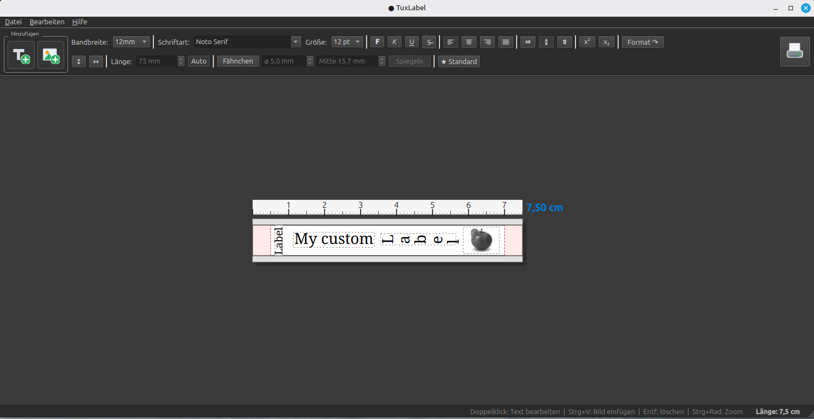

# TuxLabel

**Etiketten-Editor für Brother P-Touch Drucker (TZe-Bänder) unter Linux.**

[](../../releases/latest)
[](LICENSE)
[](https://paypal.me/CKrogmann)

*(English version below — [jump to English](#tuxlabel-english))*



TuxLabel ist ein Desktop-Programm für Linux, mit dem sich Etiketten für den
Brother PT-P700 gestalten und direkt über CUPS ausdrucken lassen — inklusive
maßstabsgetreuer Vorschau (WYSIWYG), Bildern und einem eigenen Modus für
Kabelfähnchen. Weitere Brother Label Drucker sind aktuell ungetestet, können aber
auch angefragt werden, siehe [Projekt unterstützen](#projekt-unterstützen).

**[⬇ Herunterladen und installieren](../../releases/latest)** — für Ubuntu,
Linux Mint und Debian als `.deb` Paket. Zum installieren einfach die .deb Datei starten.
[für andere Distributionen siehe hier](#andere-distributionen--über-den-quellcode).

> ### ☕ TuxLabel ist kostenlos
>
> Wenn es für euch hilfreich ist, könnt ihr die Weiterentwicklung mit einer Spende
> unterstützen — **allgemein** für das Projekt oder **gezielt für ein
> Druckermodell**, das TuxLabel noch nicht kennt. Kommt genug für ein bestimmtes Gerät und
> Bänder zusammen, kaufe ich es und baue die Unterstützung gern ein.
>
> [](https://paypal.me/CKrogmann)
>
> Wie die Zuordnung von Spenden zu einem Modell funktioniert, steht unter
> [Projekt unterstützen](#projekt-unterstützen).

---

## Funktionen

**Bearbeitung**
* Textfelder mit freier Schriftart, -größe und -stil (fett, kursiv,
  unterstrichen, durchgestrichen), Ausrichtung links/zentriert/rechts/Blocksatz
* Bilder aus Datei oder direkt aus der Zwischenablage (`Strg+V`)
* Verschieben per Maus oder Pfeiltasten (1 mm, mit `Strg` in 0,1-mm-Schritten),
  Größenänderung über Anfasser
* Schatten je Textfeld — grauer Schatten hinter der Schrift, der auch
  auf dem Band grau erscheint
* Format übertragen von einem Textfeld auf ein anderes
* Schriftrichtung je Textfeld: waagerecht, vertikal oder um 90° gekippt —
  für Bänder, die hochkant aufgeklebt werden
* Elemente vertikal auf dem Band und horizontal auf dem Etikett zentrieren
* Rückgängig (bis zu 50 Schritte), Ausschneiden/Kopieren/Einfügen, Verdoppeln
* Datum und Uhrzeit einfügen (`F5`)

**Band und Etikett**
* Bandbreiten 3,5 / 6 / 9 / 12 / 18 / 24 mm
* Lineal in Zentimetern, Zoom über `Strg` + Mausrad
* Feste Etikettenlänge oder **Auto**-Länge, die mit dem Inhalt mitwächst

**Kabelfähnchen-Modus**
* Teilt das Band in linkes Fähnchen · Mittelbalken · rechtes Fähnchen
* Der Mittelbalken wird aus dem Kabeldurchmesser berechnet (Umfang = π × ⌀),
  damit die Beschriftung nicht auf dem umschlungenen Kabel liegt
* Optionales Spiegeln der linken auf die rechte Hälfte und eine druckbare
  Falzlinie in der Mitte

**Drucken**
* Ausgabe über CUPS (`lp`) an den PT-P700 oder andere Modelle
* Druckmodus wählbar: Linien-Modus für Text, Dithering für Fotos
* Prüfung, ob die eingestellte Bandbreite zum eingelegten Band passt

**Programm**
* Dateiformat `.ptle` (JSON, Koordinaten in Millimetern), Verlauf der zuletzt
  geöffneten Dateien
* Darkmode vorhanden
* Speicherbare Voreinstellungen für Bandbreite, Schriftart, -größe und -stil
* Mehrsprachig: Deutsch ist fest eingebaut, Englisch/Spanisch/Französisch liegen als
  JSON-Dateien bei — eigene Übersetzungen sind ohne Programmieren möglich
  (siehe [lang/README.md](lang/README.md))

## Installation

### Ubuntu, Linux Mint, Debian — ohne Terminal

1. Die **[Releases-Seite](../../releases/latest)** öffnen und unter *Assets*
   die Datei mit der Endung **`.deb`** anklicken — sie heißt
   `tuxlabel_<version>_all.deb`.

   > Nicht „Source code (zip)" oder „Source code (tar.gz)" nehmen! Das ist
   > der Quellcode für Entwickler und lässt sich nicht per Doppelklick
   > installieren.

2. Die heruntergeladene Datei **doppelklicken**. Die Paketverwaltung öffnet
   sich und fragt nach dem Passwort.
3. Fertig — **TuxLabel** steht im Anwendungsmenü unter *Büro*.

Alles Weitere geschieht von selbst: PyQt6 wird als Abhängigkeit
mitinstalliert, Menüeintrag und Programmsymbol kommen mit. Entfernen lässt
sich TuxLabel wie jedes andere Programm über die Anwendungsverwaltung.

Wer das Terminal bevorzugt:

```bash
cd ~/Downloads && sudo apt install ./tuxlabel_*_all.deb
```

### Andere Distributionen — über den Quellcode

Fedora, Arch, openSUSE und alles andere: TuxLabel ist reines Python, es muss
nichts kompiliert werden.

```bash
git clone https://github.com/Neklor/TuxLabel.git
cd TuxLabel
```

PyQt6 über die Paketverwaltung der Distribution installieren, zum Beispiel:

| Distribution | Befehl |
| --- | --- |
| Ubuntu / Mint / Debian | `sudo apt install python3-pyqt6 python3-pyqt6.sip` |
| Fedora | `sudo dnf install python3-pyqt6` |
| Arch / Manjaro | `sudo pacman -S python-pyqt6` |
| openSUSE | `sudo zypper install python3-qt6` |

Alternativ in einer virtuellen Umgebung:

```bash
python3 -m venv .venv
source .venv/bin/activate
pip install -r requirements.txt
```

Starten:

```bash
python3 main.py
```

Und optional einen Eintrag im Anwendungsmenü samt Desktop-Verknüpfung
anlegen — das Skript verändert nichts außerhalb des Benutzerverzeichnisses:

```bash
python3 install_shortcut.py
```

### Selbst ein .deb bauen

```bash
./tools/build-deb.sh          # Ergebnis: dist/tuxlabel_<version>_all.deb
```

Braucht `dpkg-deb` und PyQt6 (Letzteres nur, um die Programmsymbole zu
rendern). Die Versionsnummer zieht das Skript aus `tuxlabel/__init__.py`.

## Drucker einrichten

TuxLabel rendert das Etikett in ein PNG mit 180 dpi und übergibt es via `lp`
an CUPS. Der Drucker muss also als CUPS-Drucker vorhanden sein. 

Überprüfen mit:

```bash
lpstat -p          # eingerichtete Drucker anzeigen
```

Erscheint der PT-P700 in dieser Liste, findet ihn auch der Druckdialog von
TuxLabel. Falls nicht, fehlt der CUPS-Treiber: Für P-Touch-Geräte unter Linux
ist das `printer-driver-ptouch` — in Ubuntu, Mint und Debian direkt in den
Paketquellen, in Fedora als `ptouch-driver`, in Arch im AUR.

```bash
sudo apt install printer-driver-ptouch     # Ubuntu / Mint / Debian
```

> **Hinweis:** Die im Werkzeugkasten eingestellte Bandbreite muss dem
> eingelegten TZe-Band entsprechen — sonst quittiert der PT-P700 den Auftrag
> mit rot blinkender Anzeige.

### Getestete Modelle

Welche Geräte überhaupt in Frage kommen, entscheidet `printer-driver-ptouch`
und nicht TuxLabel: Was dort eine PPD erhält und in `lpstat -p` auftaucht,
findet auch der Druckdialog. Diese Modelle sind tatsächlich im Einsatz:

| Modell | Rückmeldung |
| --- | --- |
| **PT-P700** | Entwicklungsgerät — hier wird jede Funktion vor dem Release gedruckt |
| **PT-2430PC** | Von einem Nutzer als einwandfrei funktionierend gemeldet |

Welche Bandbreiten zur Verfügung stehen, hängt dabei vom Modell ab: Das
PT-2430PC kennt zum Beispiel die 3,5-mm-Breite nicht, die das PT-P700 anbietet.
Eine im Werkzeugkasten gewählte Breite, die das Gerät nicht beherrscht, lehnt
der Drucker ab.

Läuft TuxLabel bei dir mit einem anderen Modell? Eine kurze Rückmeldung über
ein [Issue](../../issues) genügt, und es kommt hier mit auf die Liste.

## Voraussetzungen

Bei der Installation über das `.deb`-Paket kümmert sich die Paketverwaltung
darum; diese Liste ist für alle anderen Wege gedacht.

* Linux (entwickelt und getestet unter Linux Mint / Ubuntu)
* Python **3.10** oder neuer
* PyQt6
* `cups-client` für den Befehl `lp` — nur zum Drucken
* CUPS mit eingerichtetem Brother-PT-P700-Treiber — nur zum **Drucken**
  erforderlich; Entwerfen und Speichern funktioniert auch ohne Drucker

Der Editor ist nicht an den PT-P700 gebunden — andere P-Touch-Modelle mit
CUPS-Treiber funktionieren ebenfalls, siehe [Getestete
Modelle](#getestete-modelle).

### Und macOS?

Nicht unterstützt und nicht geplant. Das Programm selbst ist nicht an Linux
gebunden — PyQt6 läuft auch auf macOS, und im Code stecken keine
linuxspezifischen Pfade —, aus dem Quellcode dürfte der Editor dort also
starten. Das **Drucken** wäre dagegen Neuarbeit: TuxLabel spricht mit der PPD
des Linux-Treibers `printer-driver-ptouch` und verlässt sich auf dessen
Seitennamen, Optionen und die daran ausgemessenen Druckränder. Brother liefert
für macOS einen eigenen Treiber mit anderem Optionssatz; das müsste an echter
Hardware neu vermessen werden — die habe ich nicht.

Dazu kommt der wichtigere Grund: Für macOS gibt es P-touch Editor von Brother,
kostenlos und gepflegt. TuxLabel ist entstanden, weil es für **Linux** nichts
Vergleichbares gibt. Dort ist die Lücke, dort bleibt die Priorität. Beiträge
dazu sind willkommen, getestet werden können sie von mir aber nicht.

## Tastenkürzel

| Kürzel | Funktion |
| --- | --- |
| `Strg+N` / `Strg+O` / `Strg+S` | Neu / Öffnen / Speichern |
| `Strg+Umschalt+S` | Speichern unter |
| `Strg+Z` | Rückgängig |
| `Strg+X` / `Strg+C` / `Strg+V` | Ausschneiden / Kopieren / Einfügen |
| `Entf` | Löschen |
| `Strg+D` | Verdoppeln |
| `Strg+A` | Alles markieren |
| `F5` | Datum und Uhrzeit einfügen |
| Pfeiltasten | Um 1 mm verschieben |
| `Strg`+Pfeiltasten | Um 0,1 mm fein verschieben |
| `Strg`+Mausrad | Zoom |
| `Strg+P` | Drucken |

Die vollständige Liste steht im Programm unter *Hilfe → Tastenkürzel*.

## Projektstruktur

```
main.py                 Einstiegspunkt (QApplication, Sprache, Design)
install_shortcut.py     Legt Menüeintrag und Desktop-Verknüpfung an
requirements.txt        Python-Abhängigkeiten
tools/
  build-deb.sh          Baut das installierbare .deb-Paket
tuxlabel/
  main_window.py        Hauptfenster, Menüs, Werkzeugleiste
  label_canvas.py       Szene und Ansicht des Etiketts, Bandmaße, Fähnchen
  text_item.py          Textelement inkl. Inline-Editor
  image_item.py         Bildelement mit Größenanfassern
  printer.py            Rendern und Übergabe an CUPS
  serialization.py      Lesen und Schreiben des .ptle-Formats
  dialogs.py            Einstellungen, Über, Tastenkürzel, Hilfe
  i18n.py               Sprachverwaltung (Deutsch eingebaut)
  theme.py              Helles und dunkles Design
  icons.py              Zur Laufzeit gezeichnete Symbole
lang/                   Sprachdateien (en, es, fr) + Anleitung
```

## Ausblick

Heute ist TuxLabel auf Brother P-Touch zugeschnitten, entwickelt und getestet
am PT-P700. Das ist aber nur der Anfang: Ziel ist ein Etiketten-Editor für
Linux, der **Etikettendrucker verschiedener Hersteller** bedienen kann. Der
Editor selbst rechnet bereits in Millimetern und rendert seitenunabhängig — der
herstellerspezifische Teil steckt fast vollständig in
[tuxlabel/printer.py](tuxlabel/printer.py) und den Bandmaß-Tabellen in
[tuxlabel/label_canvas.py](tuxlabel/label_canvas.py).

Was dem im Weg steht, ist keine Programmierarbeit, sondern Hardware: Ein Modell
zuverlässig zu unterstützen heißt, es tatsächlich in der Hand zu haben —
Papierformate, Ränder und Treibereigenheiten lassen sich nicht erraten. 
Genau dafür könnt ihr dieses Projekt unterstützen.

## Projekt unterstützen

TuxLabel entsteht in meiner Freizeit und ist kostenlos. Wenn es euch gefällt,
könnt ihr die Weiterentwicklung mit einer Spende unterstützen:

[](https://paypal.me/CKrogmann)

Es gibt zwei Wege, und ihr entscheidet über das **Nachrichtenfeld** von PayPal,
welchen ihr wählt:

**1. Allgemein für das Projekt** — einfach ohne Nachricht senden. Fließt in
Pflege, Fehlerbehebung und neue Funktionen.

**2. Gezielt für ein Druckermodell** — die genaue Modellbezeichnung in die
Nachricht schreiben, zum Beispiel:

```
Für Brother PT-P710BTH
```

Spenden mit Modellangabe sammle ich pro Modell. Reicht der Betrag für das Gerät
plus passende Bänder, kaufe ich es und baue die Unterstützung ein. Das Modell
muss also benannt werden — ohne Angabe kann ich die Spende nicht zuordnen und
behandle sie als allgemeine Unterstützung.

Praktische Hinweise:

* Welche Modelle bereits gewünscht wurden, steht in den
  [Issues mit dem Label `printer-request`](../../issues?q=label%3Aprinter-request).
  Fehlt dein Modell, eröffnet gern ein Issue — auch ohne Spende: das zeigt mir,
  wofür Bedarf besteht.
* Über die Schaltfläche **Sponsor** oben auf der Projektseite geht es zum
  gleichen Link.

Spenden sind freiwillige Unterstützung eines privaten Freizeitprojekts. Sie
sind keine Bestellung und begründen keinen Anspruch auf eine bestimmte
Funktion, ein bestimmtes Modell oder einen Zeitplan — ich sage aber offen, wenn
ein Modell zusammengekommen ist und woran ich arbeite.

## Mitmachen

Fehlerberichte und Pull Requests sind willkommen. 
Hilfreich sind:

* **Übersetzungen** — dafür ist kein Programmieren nötig, die Anleitung steht
  in [lang/README.md](lang/README.md)
* **Rückmeldungen zu anderen Modellen** — funktioniert der Druck? Das ist die
  einfachste Art, die Hersteller-Unterstützung auszubauen: Wer ein Gerät
  besitzt kann berichten ob es einwandfrei funktioniert oder ob es Fehler gibt,
  so muss ich nur Modelle mit Problemen oder fehlenden Funktionen kaufen.

Bitte im Fehlerbericht die Linux-Distribution, die Python- und PyQt6-Version,
das Druckermodell sowie die betroffene Bandbreite angeben.

## Lizenz

GPL-3.0-or-later — siehe [LICENSE](LICENSE).

TuxLabel benutzt PyQt6, das seinerseits unter der GPL v3 steht.

Copyright © 2026 Christoph Krogmann

---

<a name="tuxlabel-english"></a>

# TuxLabel (English)

**A label editor for Brother P-Touch printers (TZe tapes) on Linux.**

[](../../releases/latest)
[](LICENSE)
[](https://paypal.me/CKrogmann)

TuxLabel is a Linux desktop application for designing labels for the Brother
PT-P700 and printing them straight through CUPS — with a true-to-scale
(WYSIWYG) preview, image support and a dedicated cable-flag mode. Other Brother
label printers are currently untested, but can be requested — see
[Supporting the project](#supporting-the-project).

**[⬇ Download and install](../../releases/latest)** — for Ubuntu, Linux Mint
and Debian as a `.deb` package. To install, simply launch the `.deb` file.
[For other distributions, see here](#other-distributions--from-source).

> ### ☕ TuxLabel is free
>
> If you find it useful, you can support its development with a donation —
> **generally** for the project, or **earmarked for a printer model** TuxLabel
> does not know yet. Once enough comes together for a particular device and
> its tapes, I will buy it and gladly build in support.
>
> [](https://paypal.me/CKrogmann)
>
> How donations are attributed to a model is explained under
> [Supporting the project](#supporting-the-project).

### Features

* Text boxes with any font, size and style; left/centre/right/justified
  alignment
* Images from file or pasted from the clipboard (`Ctrl+V`)
* Move with the mouse or arrow keys (1 mm, or 0.1 mm with `Ctrl`), resize via
  handles, copy formatting between text boxes, centre elements on the tape
* Writing direction per text box — horizontal, vertical or tilted by 90°,
  for tapes that are applied vertically
* Shadow per text box — a grey shadow behind the text that also comes
  out grey on the tape
* Undo (up to 50 steps), insert date and time
* Tape widths 3.5 / 6 / 9 / 12 / 18 / 24 mm, ruler in centimetres,
  `Ctrl` + wheel zoom
* Fixed label length or **Auto** length that grows with the content
* **Cable-flag mode:** splits the tape into left flag · centre bar · right
  flag, sizing the centre bar from the cable circumference (π × diameter) so
  the text never ends up wrapped around the cable; optional mirroring and a
  printable fold line
* Printing via CUPS (`lp`) to the PT-P700 or other models, with a line mode
  for text and dithering for photos, plus a check that the selected tape width
  matches the loaded tape
* `.ptle` file format (JSON, millimetre coordinates), recent-files list
* Dark mode available, storable defaults
* Multilingual: German is built into the program; English, Spanish and French
  ship as JSON files, and adding your own translation requires no programming
  — see [lang/README.md](lang/README.md)

### Installation

**Ubuntu, Linux Mint, Debian — no terminal needed.** On the
**[releases page](../../releases/latest)**, download the file ending in
**`.deb`** (`tuxlabel_<version>_all.deb`) and launch it — *not* the
"Source code" archives, which cannot be installed that way. The package
manager takes care of PyQt6, the menu entry and the icon; afterwards
**TuxLabel** sits in your application menu under *Office*. From a terminal
that is `cd ~/Downloads && sudo apt install ./tuxlabel_*_all.deb`.

<a name="other-distributions--from-source"></a>

**Other distributions — from source.** TuxLabel is pure Python, nothing needs
compiling:

```bash
git clone https://github.com/Neklor/TuxLabel.git
cd TuxLabel
sudo apt install python3-pyqt6 python3-pyqt6.sip   # dnf: python3-pyqt6 · pacman: python-pyqt6
python3 main.py
```

Run `python3 install_shortcut.py` to add an application-menu entry and a
desktop shortcut; it writes nothing outside your home directory. To build the
Debian package yourself, run `./tools/build-deb.sh`.

### Setting up the printer

TuxLabel renders the label to a PNG at 180 dpi and hands it to CUPS via `lp`,
so the printer has to exist as a CUPS device. Check with:

```bash
lpstat -p          # list configured printers
```

If the PT-P700 appears in that list, TuxLabel's print dialog will find it too.
If it does not, the CUPS driver is missing: for P-Touch devices on Linux that
is `printer-driver-ptouch` — in the Ubuntu, Mint and Debian repositories, in
Fedora as `ptouch-driver`, in Arch in the AUR.

```bash
sudo apt install printer-driver-ptouch     # Ubuntu / Mint / Debian
```

> **Note:** The tape width set in the toolbar must match the TZe tape actually
> loaded — otherwise the PT-P700 rejects the job and blinks red.

#### Tested models

Which devices are possible at all is decided by `printer-driver-ptouch`, not by
TuxLabel: whatever gets a PPD there and shows up in `lpstat -p` will be found
by the print dialog as well. These models are in actual use:

| Model | Report |
| --- | --- |
| **PT-P700** | Development device — every feature is printed here before a release |
| **PT-2430PC** | Reported by a user as working flawlessly |

Which tape widths are available depends on the model: the PT-2430PC, for
instance, does not offer the 3.5 mm width that the PT-P700 does. A width chosen
in the toolbar that the device cannot handle will be rejected by the printer.

Running TuxLabel with a different model? A short note via an
[issue](../../issues) is enough and it goes on this list.

### Requirements

Handled automatically by the `.deb` package; this list applies to every other
route. Linux, Python **3.10+**, PyQt6, `cups-client` for the `lp` command, and
CUPS with a Brother PT-P700 driver. Only printing needs the last two —
designing and saving works without a printer. Other P-Touch models with a CUPS
driver work as well — see [Tested models](#tested-models).

The full keyboard shortcut list is available in the app under
*Help → Keyboard shortcuts*.

#### What about macOS?

Not supported and not planned. The application itself is not tied to Linux —
PyQt6 runs on macOS and the code contains no Linux-specific paths — so the
editor would most likely start from source. Printing is the problem: TuxLabel
talks to the PPD of the Linux `printer-driver-ptouch` driver and relies on its
page names, options and the print margins measured against it. Brother ships
its own macOS driver with a different set of options, which would have to be
re-measured on real hardware that I do not have.

The more important reason: Brother's P-touch Editor is available for macOS,
free and maintained. TuxLabel exists because there is nothing comparable for
**Linux** — that is where the gap is and where the priority stays.
Contributions are welcome, but I cannot test them.

### Roadmap

TuxLabel currently targets Brother P-Touch printers and is developed and tested
on the PT-P700 — but that is only the starting point. The goal is a Linux label
editor that drives **label printers from several manufacturers**. The editor
already works in millimetres and renders independently of any page format; the
vendor-specific part lives almost entirely in
[tuxlabel/printer.py](tuxlabel/printer.py) and the tape tables in
[tuxlabel/label_canvas.py](tuxlabel/label_canvas.py).

What stands in the way is hardware, not code: supporting a model reliably means
having it on the desk, because paper sizes, margins and driver quirks cannot be
guessed.
That is exactly why you can support this project.

### Supporting the project

TuxLabel is built in my spare time and is free. If you like it, you can support
its development with a donation:

[](https://paypal.me/CKrogmann)

There are two ways, and PayPal's **message field** decides which one you take:

**1. General support** — just send without a message. Goes into maintenance,
bug fixing and new features.

**2. Earmarked for a printer model** — put the exact model name in the message,
for example:

```
For Brother PT-P710BTH
```

Earmarked donations are pooled per model. Once a model reaches the price of the
device plus suitable tapes, I buy it and implement support. Naming the model is
what makes this work — without it I cannot attribute the donation and will treat
it as general support.

Practical notes:

* Models requested so far are tracked in the
  [issues labelled `printer-request`](../../issues?q=label%3Aprinter-request).
  If yours is missing, feel free to open an issue — donation or not, it shows
  me where the demand is.
* The **Sponsor** button at the top of the project page points to the same link.

Donations are voluntary support for a private hobby project. They are not an
order and create no entitlement to a particular feature, model or timeline — but
I will say openly when a model has been funded and what I am working on.

### Contributing

Bug reports and pull requests are welcome.
Particularly helpful are:

* **Translations** — no programming required, the guide is in
  [lang/README.md](lang/README.md)
* **Reports about other models** — the easiest way to widen vendor support:
  if you own a device, you can report whether it works flawlessly or where it
  fails, so I only need to buy models that have problems or missing features.

When reporting a bug, please include your distribution, your Python and PyQt6
versions, the printer model and the tape width involved.

### License

GPL-3.0-or-later — see [LICENSE](LICENSE). TuxLabel uses PyQt6, which is itself
licensed under the GPL v3.

Copyright © 2026 Christoph Krogmann
